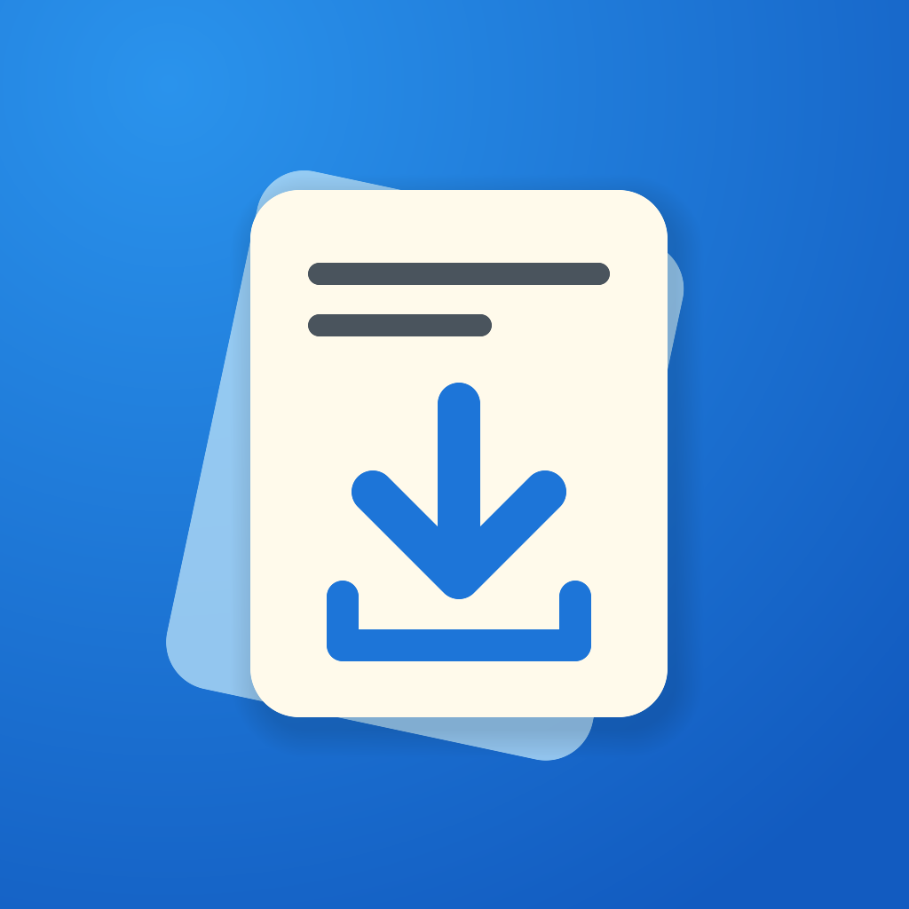

<p align="center">
  
</p>

<h1 align="center">Quby</h1>
<p align="center">A native iOS client for qBittorrent.</p>

Manage your torrents from an iPhone or iPad. Requires iOS 26 or later and a reachable qBittorrent Web UI.

## Features

- Live transfers, speed summaries, and torrent details.
- Search by name, category, or tracker.
- Multiple server instances with password or API key login.
- Add magnet links and `.torrent` files with saved location and start-paused options.
- Pause, resume, delete, and change file priorities.
- Bulk pause, resume, delete, location/category changes, recheck, and reannounce.
- Normal and alternative speed limits in Settings.
- Light, dark, or system appearance; adjustable list density and scroll effects.

## Connect

Enable the Web UI in qBittorrent, then add its full URL in **Settings → Instances**. Include the port and any reverse-proxy path. API key login requires qBittorrent 5.2 or later.

Remembered passwords and API keys are stored in the device’s Keychain. Use HTTPS when connecting outside your local network.

## Build

Use Swift 6.4 and an iOS 27 SDK. Open `Quby.xcodeproj` in Xcode, select your signing team, and build for your device.

You can also build an unsigned IPA with [xtool](https://github.com/xtool-org/xtool):

```sh
xtool dev build -c release --ipa
```

The IPA is written to `xtool/Quby.ipa`.

## License

[MIT](LICENSE)
